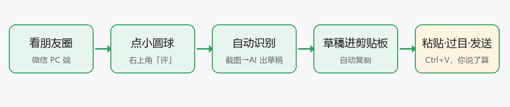
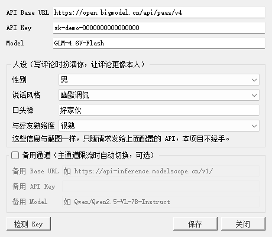
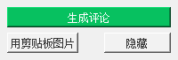

# 朋友圈评论助手 · 使用说明

> 看到好友发了条朋友圈，想回一句却懒得琢磨？点一下小圆球，它帮你想好——**你过目、你粘贴、你发送**。它只动嘴，不动手。

整个工具就干一件事：把你正在看的朋友圈截图交给 AI，生成一条**像你本人会说的话**的评论草稿，放进剪贴板。发不发、怎么改，永远你说了算。不自动点赞、不自动发送、不批量操作。

---

## 第一步：领一个免费模型钥匙（2 分钟，一次性）

工具自己不带 AI，用你自己的模型账号（这叫 BYOK）。推荐先领智谱的免费档：

1. 打开 [open.bigmodel.cn](https://open.bigmodel.cn)，注册登录
2. 控制台里创建 API Key，复制
3. 模型名填 `GLM-4.6V-Flash`——输入输出全免费

**免费通道不止一家**（高峰期限流是常态，多备一个不慌）：

| 通道 | 模型 | 费用 | 备注 |
|---|---|---|---|
| 智谱 | GLM-4.6V-Flash | 免费 | 首选；高峰会报「访问量过大」，工具自动重试 |
| 魔搭 ModelScope | Qwen/Qwen2.5-VL-7B-Instruct | 免费 | 推荐做备用通道；需绑阿里云账号实名 |
| 阿里云百炼 | qwen-vl-plus | 新用户 100 万 token/90 天 | **额度用尽会自动扣费**，怕花钱就别开 |
| 火山方舟 | 豆包 Seed Vision | 试用额度 | 活动随时变，以官网为准 |
| Ollama 本地 | qwen2.5vl 等 | 完全免费 | 截图不出本机；需约 8–10 GB 显存 |

注册入口：[智谱](https://open.bigmodel.cn) ｜ [魔搭](https://modelscope.cn) ｜ [百炼](https://bailian.console.aliyun.com) ｜ [火山](https://www.volcengine.com/product/ark) ｜ [Ollama](https://ollama.com)

## 第二步：首次运行，填配置

双击 `朋友圈评论助手.exe`（免安装）。首次启动自动弹出配置页：

- **上面三行**：Base URL、Key、模型名，照第一步填。填完点「检测 Key」，变绿 ✓ 再保存
- **人设问卷**（让评论像你的关键）：性别、说话风格、口头禅、与好友熟络度。举个例子：选「幽默调侃＋很熟」，好友晒加班它会回「辛苦了，早点歇」还是「城市灯火那是路灯电费」，就看你平时是哪款人；选「温和真诚＋偏同事客户」，它就客气克制，绝不拆台。**全部可选，不填就按普通朋友的分寸写**
- **备用通道**（可选）：把魔搭的三项填进去，主通道限流时自动切换，不用你管

> 人设和截图一样，只发往你自己配置的模型 API，本项目不经手、不收集。配置存在 `%APPDATA%\MomentsAssistant\config.json`，不进仓库。

## 第三步：日常使用，三个动作

1. 微信 PC 端打开朋友圈，窗口右上角会出现一个绿色小圆球：

2. 看到想回的那条，**点一下球**——截图、识别、出草稿，自动进剪贴板（球会显示「生成中…」，好了有提示）
3. 点开评论框，**Ctrl+V 粘贴，过目一眼，手动发送**

找不到球？它只在微信窗口在前台时出现，微信最小化就隐藏。也可以右键托盘图标唤出备用浮窗：

「用剪贴板图片」按钮：手机截图传到电脑后，直接 Win+Shift+S 截一下再点它，同样出草稿。

---

## 常见问题

**总提示「访问量过大」？**
免费公共池高峰限流，不是你的问题。工具会自动重试 2 次（隔 2 秒、4 秒），再失败就切你配的备用通道。都没配或都挂了，等几分钟再点，或换本地 Ollama。

**要花多少钱？**
免费通道 ¥0。就算用付费档兜底：智谱 FlashX 约 **0.024 分/条**，标准档约 0.13 分/条，最贵的阶跃约 0.4 分/条——**1000 条评论不到 4 块钱**。截图已自动压缩（体积缩到约 27%），这是省钱的大头。

**评论还是不够像我？**
把人设问卷填上，尤其「口头禅」和「熟络度」。它按帖子氛围定语气：喜事祝贺、坏消息关心（绝不幽默）、日常才调侃。幽默是调味料不是主菜。

**隐私安全吗？**
零注入、零 UIA、不读微信进程内存，只截屏幕；数据不经手项目方，没有我们的服务器。唯一外发就是你自配的模型 API——选哪家，看哪家隐私政策。

**界面动画卡？**
配置里 `VL_ANIMATIONS=0` 一键全关。

---

## 必读

本工具违反微信用户协议，账号有被限制功能或封停的风险，**使用即视为知悉并自担**。仅限本人账号、个人学习研究，禁止商用营销批量操作。完整六条免责声明见 [README](../README.md)。
